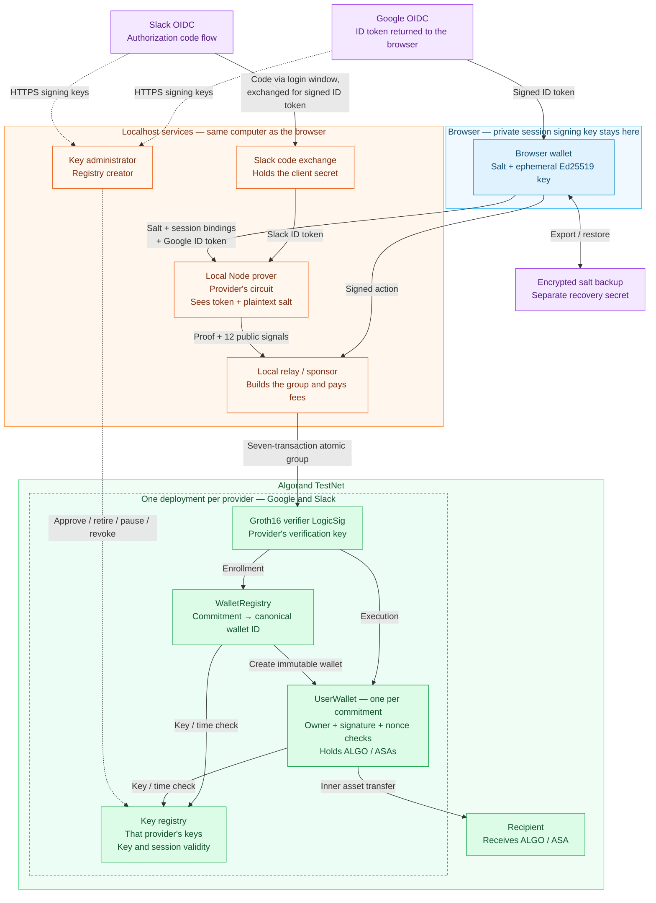

# AlgoZKAuth — zero-knowledge authorization on Algorand

AlgoZKAuth is a proof of concept that uses a Google or Slack login to authorize an independent Algorand application wallet. A zero-knowledge proof verifies the provider's OpenID Connect ID token and binds a temporary browser signing key to a salted identity commitment. The wallet checks that proof, current signing-key policy, the exact signed action and its replay nonce before transferring ALGO or Algorand Standard Assets (ASAs).

**[See it on the showcase page](https://bwmx.github.io/algo-zkauth/):** replay the recorded TestNet run and re-verify its zero-knowledge proofs and signatures in your browser. To run the demo yourself, see [Run the demo](#run-the-demo).

**The local desktop/TestNet scenario passed on 2026-10-09:** two genuine Google identities enrolled separate wallets and transferred ALGO/ASA; replay and cross-wallet authorization attempts were rejected. Restoring an encrypted backup after a Chrome reload recovered the original wallet, and a fresh Google session authorized further transfers. [Acceptance evidence](benchmarks/phase6-acceptance.testnet.json) records 11/11 checks across ten confirmed action groups. **Sign in with Slack followed on 2026-10-12:** two genuine Slack identities enrolled wallets through a separate Slack deployment, transferred ALGO/ASA and were rejected at each other's wallets ([9/11 checks](benchmarks/slack-acceptance.testnet.json); Slack restore and fresh-session renewal have not been run). Physical second-device recovery and production readiness remain open.

## Architecture

The diagram shows the integrated TestNet demo. Solid arrows carry login, proof, action or recovery data; dashed arrows show signing-key administration. Each `UserWallet` is a separate application account for one salted identity commitment. Google and Slack each have their own circuit and their own deployment of the same contracts, and the relay submits to the deployment of the token's provider. A proof or signing key from one provider is rejected by the other's deployment.



The verifier LogicSig signs the proof-carrying app call; proof verification and app execution occur in the same atomic group. The registry and wallet also check the configured audience/network and current key/session policy. The sponsor does not hold the browser's session key. The local prover **does see the token and salt**; only the proof and public signals go on-chain, alongside the signed action. Google returns its ID token to the browser. Sign in with Slack instead returns an authorization code to a login window, and the localhost server exchanges it with the Slack app's client secret, so the Slack token never enters the page.

Restoration recovers the same salt and commitment, so registry discovery returns the original wallet; a new login creates a new session key. Secret restoration to the original wallet passed for Google on the same Mac, including in a second browser: on 2026-10-20 Safari 27 restored a wallet enrolled in Chrome from its wallet-bound backup file and secret, and authorized transfers under a fresh session key ([acceptance](benchmarks/key-governance-acceptance.testnet.json)). In the same run Chrome rediscovered an earlier wallet after the operator unlocked its backup with a passkey; the record does not capture the unlock method and no transfer followed. Slack restoration, cross-browser passkey use and physical second-device recovery remain unverified; they are listed as [deferred manual checks](PLAN.md#deferred-manual-checks).

## How it works

1. **Login and session binding.** The browser creates a nonextractable Ed25519 key. The login provider (Google or Slack) signs a nonce that binds its public key, the Algorand network, randomness and a session expiry of at most ten minutes.
2. **Persistent identity.** A random 32-byte salt combines with the provider's canonical issuer, OAuth audience and subject to produce the wallet's identity commitment. The subject is `sub` for Google and `team_id/sub` for Slack, whose user IDs are workspace-scoped. The salt survives session renewal through an encrypted backup.
3. **Proof generation.** A Circom circuit for that provider verifies the RS256 token and identity/session bindings. Groth16 over BN254 produces the same twelve public signals for both providers. The integrated demo sends the token and plaintext salt to a **localhost Node prover**; the browser retains its private session key.
4. **Enrollment and authorization.** The provider's verifier LogicSig participates in a seven-transaction atomic group. That provider's `WalletRegistry` creates one immutable `UserWallet` application per commitment. The wallet independently checks the proof, its provider's key-registry policy, signed action fields and nonce. Both providers' key registries are deployments of the `GoogleKeyRegistry` contract, left unrenamed so its bytecode stays identical.
5. **Backup and restoration.** The browser encrypts the salt with AES-256-GCM and a generated recovery secret, with optional passkey PRF unlocking. The interface requires export/import and successful secret restoration before proving/enrollment. Restoration recomputes the original commitment and discovers the existing wallet.

Registry uniqueness applies to the **salted commitment**, not globally to a Google or Slack account. Generating a different salt creates a different identity and wallet. A provider login alone cannot recover a lost salt.

## What the POC proved

| Capability | Recorded result | Evidence |
| --- | --- | --- |
| Algorand Groth16 verification | Custom proofs verified independently and confirmed on LocalNet; a seven-signal synthetic proof also confirmed on TestNet | [Verifier benchmarks](docs/verifier-feasibility.md) |
| Full Google JWT proof | Genuine Google token verified through the twelve-signal circuit and TestNet authorization path | [Protocol and evidence](docs/phase3-protocol.md) |
| Independent asset wallets | Two synthetic identities passed 46 LocalNet wallet checks, including signed-field changes, replay, isolation, rollback and session boundaries | [Wallet specification](docs/phase4-wallets.md) |
| Integrated Google wallets | Two genuine Google identities enrolled wallets `773944646` and `773945687`, transferred ALGO/ASA and passed recorded node rejection checks | [TestNet POC report](docs/poc-report.md) |
| Slack as a second provider | Two genuine Slack identities enrolled wallets `774125965` and `774127169` with the unchanged contracts, transferred ALGO/ASA and were rejected at each other's wallets; on LocalNet, Slack and Google proofs were each rejected by the other's deployment | [Slack protocol and evidence](docs/slack-oidc.md) |
| Original-wallet recovery and renewal | Google Account A secret-restored its backup after Chrome reload; its original wallet accepted transfers under a fresh session key | [Integrated acceptance](benchmarks/phase6-acceptance.testnet.json) |
| Recovery after deleting original client state | A separate Node process restored the same salt and LocalNet wallet and confirmed a transfer using a fresh synthetic JWT | [Recovery evidence](docs/phase5-recovery.md) |
| Genuine-token browser proving | Chrome 155 proved a **genuine Google token**, single-threaded, in 143.2 seconds; the server independently verified it. Chrome's Task Manager showed a 3.6–3.8 GB tab footprint. Not submitted on-chain | [Genuine browser benchmark](benchmarks/phase3-browser-google.json) |
| Desktop browser proving | Chrome 154 generated a full-circuit proof with a **synthetic token**, single-threaded, in 423.688 seconds; the server independently verified it | [Browser benchmark](benchmarks/phase3-browser.json) |

The acceptance checker retrieves historical TestNet blocks and verifies exact transaction IDs, complete groups, deployed wallet/registry code and policy, proof bytes, Ed25519 action signatures, transfers, fees and current wallet state. Rejected transactions have no confirmed block record: replay/isolation results rely on sanitized local records of actual node rejection. Google identity labels also rely on the local login verifier. These evidence boundaries are detailed in [the POC report](docs/poc-report.md).

## Measured costs

| Measurement | Result |
| --- | --- |
| Full JWT circuit | Google 2,726,377 constraints; Slack 2,563,372; twelve public signals each |
| Development proving key | Google 1,425,797,992 bytes (1.426 GB / 1.328 GiB); Slack 1,360,364,984 bytes (1.360 GB / 1.267 GiB) |
| Four integrated genuine Google proofs | 124.751–130.697 seconds; 1,705–2,213 MiB sampled peak Node RSS |
| Three integrated genuine Slack proofs | 123.963–124.918 seconds; 1,785–2,331 MiB sampled peak Node RSS |
| Synthetic-token proof with rapidsnark | Google circuit, same proving key, snarkjs-verified: 8.7 s total (2.7 s witness, 5.9 s proving) natively on macOS/arm64; 9.3 s in a Linux/arm64 Docker container. The same witness took 125.1 s with snarkjs. Genuine-token runs through the integrated demo have not been recorded |
| Synthetic-token Chrome proof | 423.688 seconds; browser memory unavailable; key loaded from localhost |
| Complete enrollment / execution group | Seven outer transactions; eight / seven inner transactions |
| Tested complete-action fee | 0.020000 ALGO per group, sponsor-paid; includes margin |
| Enrollment deposit | 0.454800 ALGO per wallet, separate from fees |
| Additional ASA opt-in minimum balance | 0.100000 ALGO per asset |
| Observed TestNet action confirmation | 3.915–6.257 seconds in the Google run; 4.701–6.207 seconds in the Slack run |

The integrated measurements used Chrome 154 and Node v24.15.0 on macOS/arm64. Group simulations measured 78,378 LogicSig opcodes plus 3,174 app opcodes for enrollment or 2,967–2,979 for execution, the same for both providers, whose deployments run identical contracts. Group size and fee were also the same. Opcode counts come from simulation; transfers and fees were independently checked in confirmed blocks. These are recorded observations, not latency guarantees or optimized minimum fees. [Detailed feasibility analysis](docs/verifier-feasibility.md).

## What we learned

- **The complete authorization path fits Algorand.** The real twelve-signal verifier, key-policy check, Ed25519 action signature, replay counter and asset transfer work together in confirmed groups. Small synthetic verifier benchmarks alone would not have established this.
- **Proof generation dominated the recorded experience.** Local Node proofs with snarkjs took about two minutes; swapping in the native rapidsnark prover cut a synthetic-token proof to under ten seconds with the same key and verifier. Chrome's first full proof took about seven minutes of a ten-minute session; a later genuine-token proof in Chrome 155 took 143 seconds and about 3.7 GB, a cause not isolated. The default parallel browser worker failed with an allocation error; single-thread proving with 4 MiB key pages succeeded. Hosted key-download cost, peak browser memory and mobile performance remain unmeasured.
- **Recovery depends on preserving the exact salt.** An exported encrypted file and separate secret recovered the original wallet. A Chrome passkey attempt first recorded `prf-unavailable`; a later operator-reported Chrome 155 passkey unlock rediscovered its wallet. Safari restored a Chrome-created wallet from the file and secret. Physical second-device recovery is still unverified.
- **Identity proof and action authorization are separate checks.** A reusable session proof does not authorize arbitrary transfers. Every action binds the network, registry, wallet, owner, operation, recipient, asset, amount, expiry and current wallet nonce.
- **Each provider needs its own circuit and deployment.** Slack escapes `/` in its signed JSON, issues five-minute tokens and scopes user IDs to a workspace. Its circuit therefore matches the escaped spelling, uses `team_id/sub` as the subject and bounds the session by token issue time rather than token expiry. Separate key registries and verifiers stop one provider's signing key from vouching for the other provider's identities. The wallet contracts, action format and recovery format did not change.
- **Key governance is an availability and security dependency.** The registry creator is trusted to approve authentic Google and Slack keys, retrieved over HTTPS off-chain. The chain does not authenticate their origin. A malicious administrator with the identity and salt could approve an attacker-controlled key and authorize that wallet; this is a [code-derived trust implication](docs/sui-comparison.md#trust-and-privacy-differences), not a tested exploit. Overlap, retirement, pause and permanent revocation were tested. New deployments now limit this authority: after deployment, a new key or a renewal takes effect only 24 hours after the administrator approves it, and a separate guardian account can revoke it or pause the registry in that time. This is LocalNet-tested, and on TestNet it passed disposable policy checks and an integrated single-identity run, including Safari recovery; the two-account acceptance recordings predate it ([design](PLAN.md#key-governance--approval-delay-and-guardian)).

## Relationship to Sui zkLogin

AlgoZKAuth follows the OAuth nonce → temporary signing key → zero-knowledge proof → authorized action pattern described in [Sui's zkLogin overview](https://docs.sui.io/sui-stack/zklogin-integration). It implements that pattern using Algorand LogicSigs and application wallets. Its circuit, account derivation, session encoding, signing-key authority and recovery format are independent of Sui's implementation. The TestNet results demonstrate this authorization pattern on Algorand; they do not establish equivalent security, recovery UX or performance. [Detailed comparison](docs/sui-comparison.md).

Aptos Keyless uses the same pattern but derives each user's blinding value (its *pepper*) from a deterministic pepper service, so a fresh login alone recovers the account. This POC instead keeps a user-held random salt in an encrypted backup. With a single key administrator, a pepper service would hold every salt that a forged-key takeover needs. [Aptos comparison and salt options](docs/aptos-comparison.md).

The project rename preserves the existing v1 cryptographic domain strings, environment variable names and backup format identifiers. Existing proofs, deployed contracts and recovery files retain their original protocol encodings.

## Slack sign-in

Slack is a second login provider. It has its own circuit, development key and deployment of the unchanged contracts, so neither provider's signing keys or proofs work in the other's wallets. A Slack wallet identity is the workspace and user (`team_id/sub`) under the same salted commitment. Slack ID tokens last five minutes, so the Slack circuit lets a session run up to ten minutes from token issue, whereas Google's ends by the token's expiry.

Two genuine Slack identities enrolled TestNet wallets and authorized ALGO and ASA transfers. The node rejected replays and rejected each identity's proof at the other's wallet. Read-only acceptance independently verified all twelve confirmed groups (9/11 checks). On LocalNet, Slack and Google proofs were each rejected by the other's deployment. **Slack backup restore to an existing wallet, and fresh-session renewal, have not been run.** PKCE-enabled Slack apps need an https redirect relay. [Slack protocol and evidence](docs/slack-oidc.md).

## Limits of this result

This is an **unaudited TestNet POC with a development Groth16 setup**. The custom circuits/contracts/adapters and pinned verifier need independent security review and production setup provenance before asset-safety claims can be made.

The JWT circuit accepts a constrained compact ASCII/RSA-2048 profile with a 1,015-byte signed-message limit. Some valid Google tokens, including Unicode or larger profiles, are excluded. The Slack circuit accepts a fixed claim profile, so the demo requests only the `openid` scope; other Slack accounts and workspaces, notably Enterprise Grid, have not been tested. Mobile support, successful passkey PRF recovery, another browser and a second physical device have not been demonstrated.

The localhost server sees the Google or Slack identity, token and salt, and holds the Slack app's client secret. Private witness inputs are removed after normal completion/failure, but a crash can leave local files. The browser keeps its session signing key and recovery secret; this design does not establish privacy for a hosted prover. Backup verification is an interface/server gate, with a separate-storage confirmation; it is not an on-chain guarantee of external backup durability. Losing all backup copies, or both the secret and usable PRF credentials, prevents recovery.

## Run the demo

Each person who runs the demo deploys their own contracts on TestNet and is their own prover, fee sponsor and key administrator. From a fresh clone, with Node 24 or newer, git and port 8765 free:

```sh
sh scripts/quickstart.sh
```

The quickstart needs two things from you:

- **A Google OAuth client ID.** In [Google Cloud Console](https://console.cloud.google.com/apis/credentials), create an OAuth client of type *Web application* and add `http://localhost:8765` to its Authorized JavaScript origins. The quickstart asks for the ID and saves it in the ignored `.env`.
- **About 5 TestNet ALGO.** If `.env` has no `TESTNET_MNEMONIC`, the quickstart creates a new TestNet account, saves it in `.env` and prints its address. It also creates a key-registry guardian account (`KEY_GUARDIAN_MNEMONIC`) unless `.env` names one with `KEY_GUARDIAN_ADDRESS`. Fund it from the [TestNet dispenser](https://dispenser.testnet.aws.algodev.network/); the quickstart continues when the funds arrive.

It then installs the pinned dependencies, downloads the 1.4 GB proving key and verifies it against [its pinned SHA-256](fixtures/artifacts.json), deploys this clone's contracts and opens [the demo](http://localhost:8765/demo/). Rerun it any time; finished steps are skipped and the deployment is reused. A fresh clone completed this path on 2026-10-13, from a new deployment through genuine Google sign-in, transfers, replay rejection and session renewal; every confirmed action re-verified from public chain data ([record](PLAN.md#phase-6--integrate-the-testnet-demonstration)). A proof takes about 10 seconds with the native rapidsnark prover the quickstart installs (about two minutes with the snarkjs fallback, used where no rapidsnark build exists) and about 2.5 GB of memory. Use a TestNet-only account and keep `.env` private. The downloaded proving key comes from this project's development setup; whoever ran that setup could forge proofs, which is acceptable for TestNet only.

**With Docker (Linux).** The same quickstart runs in a Linux container, so nothing but Docker is needed on your machine. Allow Docker at least 4 GB of memory.

```sh
docker compose run --rm --service-ports demo
```

The container uses your checkout for `.env`, the downloaded proving keys and run records, publishes port 8765 only on `127.0.0.1`, and keeps its Linux-built dependencies in Docker volumes. It runs natively on Apple Silicon and on Linux/arm64 or x86-64 hosts. A synthetic-token proof took 9.3 s in a Linux/arm64 container on Apple Silicon, against 8.7 s natively.

In the demo, each account signs in, creates/restores its salt, exports/imports its backup and verifies secret restoration, then clicks **Generate local proof** and **Run ALGO / ASA demo**. Use separate tabs for two accounts and generate one proof at a time. Download the updated wallet-bound backup after enrollment. Besides the guided steps, the interface shows the session countdown, proof stages, wallet balances and TestNet history, a custom-transfer review before signing, an inspector for the nonce, token, public signals, signed action and atomic group, and where the salt is held. [Full operating instructions](docs/poc-report.md#start-and-repeat-the-demo).

To add Sign in with Slack, configure a Slack app and its client ID and secret in `.env` as described in [the runbook](docs/development.md#slack-sign-in), rerun the quickstart, then open [the Slack demo](http://localhost:8765/demo/?provider=slack). Slack needs its own 1.36 GB proving key, a second deployment and another 5 TestNet ALGO.

New provider keys that appear after deployment take effect 24 hours after the demo server registers them. `sh scripts/key-guardian.sh status` lists the registry's keys and exits 1 if one that is or will become valid is missing from the provider's published keys; `revoke`, `cancel-renewal` and `pause` act as the guardian.

The quickstart keeps a clone's run records in `.local/evidence/`. The recorded results in `benchmarks/` come from the maintainer's runs, which use `sh scripts/deploy-demo.sh` and `sh scripts/start-demo.sh` directly and are checked read-only with:

```sh
sh scripts/check-demo.sh
```

The checker submits no transactions. It needs the original local public proof results and private identity-audit labels as well as public chain data; a fresh checkout cannot reproduce the recorded acceptance from sanitized benchmarks alone. Exit 2 means required demo evidence is pending; exit 1 means validation failed. New deployments and reruns can produce different IDs and overwrite benchmark snapshots. Building circuits and contracts from source, rather than downloading them, is covered in [the development runbook](docs/development.md).

## Documentation and source

| Document | Purpose |
| --- | --- |
| [PLAN.md](PLAN.md) | Phase status, acceptance gates and remaining production work |
| [Feasibility report](docs/verifier-feasibility.md) | Evidence scope, costs, tested limits and conditional decision |
| [POC report](docs/poc-report.md) | Recorded TestNet deployment, acceptance and demo operations |
| [Sui comparison](docs/sui-comparison.md) | Shared authorization pattern and differences in implementation, trust and recovery |
| [Aptos comparison](docs/aptos-comparison.md) | Aptos Keyless pepper service versus this POC's user-held salt, and options for salt recovery |
| [Google proof protocol](docs/phase3-protocol.md) | Circuit bindings, public signals and key policy |
| [Slack sign-in](docs/slack-oidc.md) | Slack circuit profile, identity, deployment isolation and evidence |
| [Wallet specification](docs/phase4-wallets.md) | Enrollment, action encoding, funding and replay protection |
| [Recovery specification](docs/phase5-recovery.md) | Encrypted package, secret/PRF handling and compatibility evidence |
| [Development runbook](docs/development.md) | Pinned tools, artifact generation and phase test commands |

`contracts/`, `circuits/`, `src/` and `web/` contain the implementation; `tests/` contains automated checks; `scripts/` provides build/deployment/acceptance commands; `benchmarks/` holds sanitized measurements. Downloaded dependencies and private state live in ignored `upstream/` and `.local/` directories. The verifier is pinned to [snarkjs-algorand commit 3a970c7](https://github.com/joe-p/snarkjs-algorand/tree/3a970c7fb47efadd60c0b09a3200e8428ac47df2); its SDK is described by upstream as unstable and unaudited.
