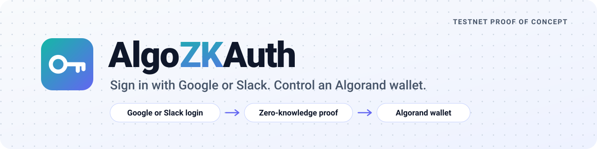
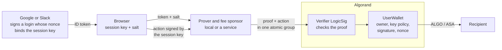
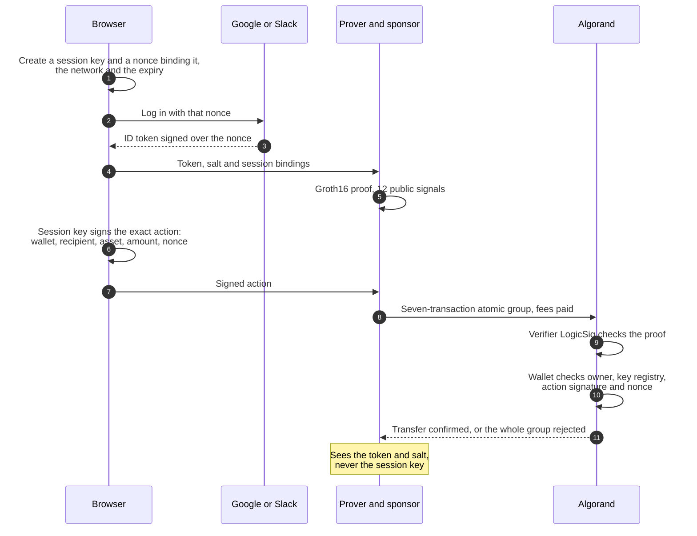
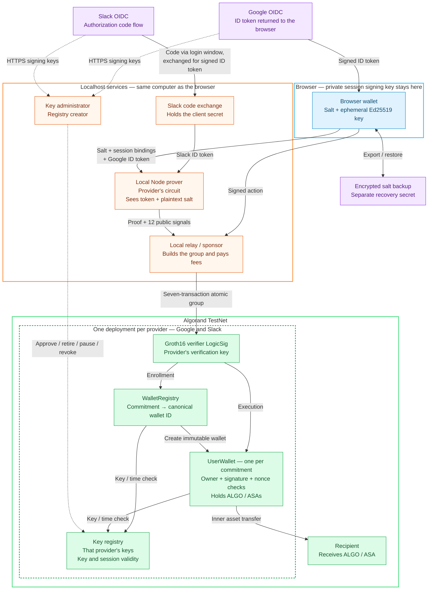
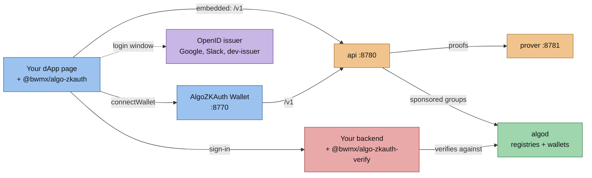

<p align="center">
  <a href="https://bwmx.github.io/algo-zkauth/">
    <picture>
      <source media="(prefers-color-scheme: dark)" srcset="docs/assets/banner-dark.svg">
      
    </picture>
  </a>
</p>

<p align="center">
  <a href="https://github.com/bwmx/algo-zkauth/actions/workflows/ci.yml"></a>
  <a href="https://bwmx.github.io/algo-zkauth/"></a>
  
  
  
  <a href="LICENSE"></a>
</p>

<p align="center">
  <a href="https://bwmx.github.io/algo-zkauth/"><b>Live showcase</b></a> ·
  <a href="#try-it"><b>Try it in one command</b></a> ·
  <a href="packages/sdk/README.md"><b>SDK guide</b></a> ·
  <a href="docs/poc-report.md"><b>POC report</b></a>
</p>

**AlgoZKAuth** lets a Google or Slack login control an Algorand wallet, with no seed phrase and no extension. A zero-knowledge proof convinces Algorand that the provider signed a login for a salted identity and a short-lived browser signing key, without putting the login on-chain. The wallet, an ordinary Algorand application, then accepts ALGO and Algorand Standard Asset (ASA) transfers signed by that key, after checking the proof, the provider's signing-key policy, the exact signed action and its replay nonce.

It is a proof of concept. Genuine Google and Slack identities ran it end to end on TestNet, and it is packaged as services and a browser SDK that run on a private LocalNet in one command. It is **unaudited, uses a development proving setup and is for TestNet only**.

## Try it

Three ways to see it, from no setup to real Google sign-in on TestNet:

| | You need | First run | You get |
| --- | --- | --- | --- |
| **[1. Showcase](#1-view-the-showcase)** | A browser | Nothing to install | The recorded TestNet run, re-verified in your browser |
| **[2. Local stack](#2-run-the-whole-stack-locally)** | Docker with 6 GB of memory | Downloads the 1.4 GB proving key | Every service on a private LocalNet with a development login: demo dApp, hosted wallet, example dApp and backend |
| **[3. TestNet stack](#3-run-on-testnet-with-real-google-sign-in)** | Docker with 6 GB, a Google OAuth client ID, about 15 TestNet ALGO | Downloads the key and deploys your own contracts | The same stack with real Google (or Slack) sign-in moving real TestNet assets |

### 1. View the showcase

Open **<https://bwmx.github.io/algo-zkauth/>**. It replays the recorded TestNet run of two Google accounts, and for any transfer fetches the transaction from a public indexer and re-checks the zero-knowledge proof and the session key's signature in your browser.

### 2. Run the whole stack locally

Needs only Docker (give it at least 6 GB of memory): no Google client and no TestNet ALGO.

```sh
git clone https://github.com/bwmx/algo-zkauth.git
cd algo-zkauth
docker compose --profile local up --build
```

The first run builds the images and downloads the 1.4 GB proving key. Once the `web` container is up, open **<http://localhost:8765>**:

1. **Sign in.** The development login issuer opens; type any subject, such as `alice`.
2. **Back up.** Download the encrypted backup and keep its secret.
3. **Enroll.** The prover makes a proof and the registry creates your wallet.
4. **Fund.** Take 5 test ALGO from the LocalNet faucet.
5. **Send** ALGO or an asset.

Then try the hosted AlgoZKAuth Wallet at <http://localhost:8770>, the example dApp at <http://localhost:8775> (a second app, so it gets a separate wallet) and its backend sign-in. Stop with `docker compose --profile local down` (add `-v` to delete the chain, state and cached key). [Everything the stack runs](#run-the-service-stack-locally).

### 3. Run on TestNet with real Google sign-in

Needs Docker and a [Google OAuth client ID](https://console.cloud.google.com/apis/credentials) (type *Web application*) whose Authorized JavaScript origins include `http://localhost:8765`, `http://localhost:8770` and `http://localhost:8775`. Put it in `.env` as `GOOGLE_CLIENT_ID`, then:

```sh
npm run stack:testnet:up     # docker compose -f compose.testnet.yaml up -d --build
```

On the first run its `init` service creates the admin, sponsor and guardian accounts and funds them from `ZKAUTH_FUNDER_MNEMONIC` if you set one (otherwise it waits for dispenser ALGO), then deploys your own contracts. The demo's faucet then gives each new wallet 1 test ALGO. Stop the local stack first: both use the same ports. Slack sign-in is optional. [Full instructions](#run-the-service-stack-on-testnet).

## How it works



1. **Login and session binding.** The browser creates a nonextractable Ed25519 key. The login provider (Google or Slack) signs a nonce that binds its public key, the Algorand network, randomness and a session expiry of at most ten minutes.
2. **Persistent identity.** A random 32-byte salt combines with the provider's canonical issuer, OAuth audience and subject to produce the wallet's identity commitment. The subject is `sub` for Google and `team_id/sub` for Slack, whose user IDs are workspace-scoped. The salt survives session renewal through an encrypted backup.
3. **Proof generation.** A Circom circuit for that provider verifies the RS256 token and identity/session bindings. Groth16 over BN254 produces the same twelve public signals for both providers. The token and plaintext salt go to a prover (the stack's prover service; a **localhost Node prover** in the original demo); the browser retains its private session key.
4. **Enrollment and authorization.** The provider's verifier LogicSig participates in a seven-transaction atomic group. That provider's `WalletRegistry` creates one immutable `UserWallet` application per commitment. The wallet independently checks the proof, its provider's key-registry policy, signed action fields and nonce. Every provider's key registry is a deployment of the same `KeyRegistry` contract (formerly `GoogleKeyRegistry`; the rename left its bytecode identical).
5. **Backup and restoration.** The browser encrypts the salt with AES-256-GCM and a generated recovery secret, with optional passkey PRF unlocking. The interface requires export/import and successful secret restoration before proving/enrollment. Restoration recomputes the original commitment and discovers the existing wallet.

Registry uniqueness applies to the **salted commitment**, not globally to a Google or Slack account. Generating a different salt creates a different identity and wallet. A provider login alone cannot recover a lost salt.

One authorized action, end to end:



<details>
<summary><b>Full architecture of the original TestNet demo (retired 2026-10-22)</b></summary>

The diagram shows the integrated TestNet demo; the service stack splits the same roles into separate services ([service architecture](docs/service-architecture.md)). Solid arrows carry login, proof, action or recovery data; dashed arrows show signing-key administration. Each `UserWallet` is a separate application account for one salted identity commitment. Google and Slack each have their own circuit and their own deployment of the same contracts, and the relay submits to the deployment of the token's provider. A proof or signing key from one provider is rejected by the other's deployment.



The verifier LogicSig signs the proof-carrying app call; proof verification and app execution occur in the same atomic group. The registry and wallet also check the configured audience/network and current key/session policy. The sponsor does not hold the browser's session key. The local prover **does see the token and salt**; only the proof and public signals go on-chain, alongside the signed action. Google returns its ID token to the browser. Sign in with Slack instead returns an authorization code to a login window, and the localhost server exchanges it with the Slack app's client secret, so the Slack token never enters the page.

</details>

Restoration recovers the same salt and commitment, so registry discovery returns the original wallet; a new login creates a new session key. For Google, restoring to the original wallet passed on the same Mac, including in a second browser: on 2026-10-20 Safari 27 restored a Chrome-enrolled wallet from its backup file and secret and authorized transfers under a fresh session key ([acceptance](benchmarks/key-governance-acceptance.testnet.json)). Passkey unlocks in Chrome, and a Chrome-to-Safari passkey restore through iCloud Keychain, are operator-reported, not machine-recorded ([recovery evidence](docs/phase5-recovery.md)). Slack restoration and physical second-device recovery remain unverified; they are listed as [deferred manual checks](PLAN.md#deferred-manual-checks).

## For dApp developers

The same wallets are packaged as services with a browser SDK, [`@bwmx/algo-zkauth`](packages/sdk/README.md). A dApp either embeds sign-in (`createZkAuth`, a wallet per user per dApp) or connects to the hosted AlgoZKAuth Wallet (`connectWallet`, one wallet per user across dApps):

```ts
const zk = createZkAuth({ service: "https://auth.example.com", app: "my-dapp" });
const session = await zk.signIn();                       // Google button
const { file, secret } = await session.backup.create();  // once per user: save both
const wallet = await session.wallet();
await wallet.sendAlgo({ to: "ADDR…", amount: algo("0.5") });
```

Its backend can sign users in with [`@bwmx/algo-zkauth-verify`](packages/verify/README.md), which checks the session key's signature and the zero-knowledge proof against the chain, so it trusts no AlgoZKAuth server.



[Run the stack locally](#run-the-service-stack-locally) · [Service architecture](docs/service-architecture.md) · [SDK guide](packages/sdk/README.md) · [Sign-in verifier](packages/verify/README.md)

## What the POC proved

**The local desktop/TestNet scenario passed on 2026-10-09:** two genuine Google identities enrolled separate wallets and transferred ALGO/ASA; replay and cross-wallet authorization attempts were rejected. Restoring an encrypted backup after a Chrome reload recovered the original wallet, and a fresh Google session authorized further transfers. [Acceptance evidence](benchmarks/phase6-acceptance.testnet.json) records 11/11 checks across ten confirmed action groups. **Sign in with Slack followed on 2026-10-12:** two genuine Slack identities enrolled wallets through a separate Slack deployment, transferred ALGO/ASA and were rejected at each other's wallets ([10/12 checks](benchmarks/slack-acceptance.testnet.json); Slack restore and fresh-session renewal have not been run). Physical second-device recovery and production readiness remain open.

| Capability | Recorded result | Evidence |
| --- | --- | --- |
| Algorand Groth16 verification | Custom proofs verified independently and confirmed on LocalNet; a seven-signal synthetic proof also confirmed on TestNet | [Verifier benchmarks](docs/verifier-feasibility.md) |
| Full Google JWT proof | Genuine Google token verified through the twelve-signal circuit and TestNet authorization path | [Protocol and evidence](docs/phase3-protocol.md) |
| Independent asset wallets | Two synthetic identities passed 46 LocalNet wallet checks, including signed-field changes, replay, isolation, rollback and session boundaries | [Wallet specification](docs/phase4-wallets.md) |
| Integrated Google wallets | Two genuine Google identities enrolled wallets `773944646` and `773945687`, transferred ALGO/ASA and passed recorded node rejection checks | [TestNet POC report](docs/poc-report.md) |
| Slack as a second provider | Two genuine Slack identities enrolled wallets `774125965` and `774127169` with the unchanged contracts, transferred ALGO/ASA and were rejected at each other's wallets; on LocalNet, Slack and Google proofs were each rejected by the other's deployment | [Slack protocol and evidence](docs/slack-oidc.md) |
| Original-wallet recovery and renewal | Google Account A secret-restored its backup after Chrome reload; its original wallet accepted transfers under a fresh session key | [Integrated acceptance](benchmarks/phase6-acceptance.testnet.json) |
| Recovery after deleting original client state | A separate Node process restored the same salt and LocalNet wallet and confirmed a transfer using a fresh synthetic JWT | [Recovery evidence](docs/phase5-recovery.md) |
| Genuine-token browser proving | Chrome 155 proved a **genuine Google token**, single-threaded, in 143.2 seconds; the server independently verified it. Chrome's Task Manager showed a 3.6–3.8 GB tab footprint. Not submitted on-chain | [Genuine browser benchmark](benchmarks/phase3-browser-google.json) |
| Native proving on genuine tokens | On the guardian-enabled TestNet deployments, the integrated demo proved genuine tokens with rapidsnark in 8.5–10.4 s (Google) and 9.7 s (Slack) | [Acceptance](benchmarks/key-governance-acceptance.testnet.json) |
| Key-approval delay and guardian | New key registries delay key approvals and renewals by 24 hours with a guardian veto: 12 LocalNet policy tests, a block-clock test of the delay elapsing, and 13/13 disposable TestNet policy checks | [Policy evidence](benchmarks/key-governance-policy.testnet.json) |
| Service stack and SDK | On a compose LocalNet with the dev issuer: Playwright drives the demo and example dApps through sign-in, backup, enrollment, transfers, recovery in a second browser profile, a passkey on a virtual PRF authenticator, a different wallet per app, the hosted wallet serving two dApps with one wallet, and backend sign-in verified against the chain from both. Development login, not Google | [Service architecture](docs/service-architecture.md) |
| Service stack on TestNet | Two genuine Google accounts (demo wallets `774739616` and `774739716`) and a Slack account (`774740015`) signed in through the SDK, enrolled and sent ALGO to each other and to an outside account; Safari restored Google wallet `774739616` from its backup and sent under a fresh session key. Replays and each proof at another identity's wallet, rebuilt from public data and simulated while the sessions were open, were rejected at the nonce and owner checks. Hosted-wallet and example wallets enrolled; the example backend verified a sign-in (off-chain). Read-only acceptance: 72/72 checks over 14 groups and 9 simulated rejections | [Service-stack acceptance](benchmarks/service-stack.testnet.json) |
| Desktop browser proving | Chrome 154 generated a full-circuit proof with a **synthetic token**, single-threaded, in 423.688 seconds; the server independently verified it | [Browser benchmark](benchmarks/phase3-browser.json) |

The acceptance checker retrieves historical TestNet blocks and verifies exact transaction IDs, complete groups, deployed wallet/registry code and policy, proof bytes, Ed25519 action signatures, transfers, fees and current wallet state. Rejected transactions have no confirmed block record: replay/isolation results rely on sanitized local records of actual node rejection. Google identity labels also rely on the local login verifier. These evidence boundaries are detailed in [the POC report](docs/poc-report.md).

## Measured costs

| Measurement | Result |
| --- | --- |
| Full JWT circuit | Google 2,726,377 constraints; Slack 2,563,372; twelve public signals each |
| Development proving key | Google 1,425,797,992 bytes (1.426 GB / 1.328 GiB); Slack 1,360,364,984 bytes (1.360 GB / 1.267 GiB) |
| Four integrated genuine Google proofs | 124.751–130.697 seconds; 1,705–2,213 MiB sampled peak Node RSS |
| Three integrated genuine Slack proofs | 123.963–124.918 seconds; 1,785–2,331 MiB sampled peak Node RSS |
| Synthetic-token proof with rapidsnark | Google circuit, same proving key, snarkjs-verified: 8.7 s total (2.7 s witness, 5.9 s proving) natively on macOS/arm64; 9.3 s in a Linux/arm64 Docker container. The same witness took 125.1 s with snarkjs |
| Genuine-token proofs with rapidsnark (integrated demo) | Google 8.5–10.4 s, Slack 9.7 s, on the Mac; about 2.5–3 GB including the prover |
| Genuine-token Chrome proof | 143.2 seconds, single-threaded (Chrome 155); Task Manager showed a 3.6–3.8 GB tab |
| Synthetic-token Chrome proof | 423.688 seconds; browser memory unavailable; key loaded from localhost |
| Complete enrollment / execution group | Seven outer transactions; eight / seven inner transactions |
| Tested complete-action fee | 0.020000 ALGO per group, sponsor-paid; includes margin |
| Enrollment deposit | 0.454800 ALGO per wallet, separate from fees |
| Additional ASA opt-in minimum balance | 0.100000 ALGO per asset |
| Observed TestNet action confirmation | 3.915–6.257 seconds in the Google run; 4.701–6.207 seconds in the Slack run |

The integrated measurements used Chrome 154 and Node v24.15.0 on macOS/arm64. Group simulations measured 78,378 LogicSig opcodes plus 3,174 app opcodes for enrollment or 2,967–2,979 for execution, the same for both providers, whose deployments run identical contracts. Group size and fee were also the same. Opcode counts come from simulation; transfers and fees were independently checked in confirmed blocks. These are recorded observations, not latency guarantees or optimized minimum fees. [Detailed feasibility analysis](docs/verifier-feasibility.md).

## What we learned

- **The complete authorization path fits Algorand.** The real twelve-signal verifier, key-policy check, Ed25519 action signature, replay counter and asset transfer work together in confirmed groups. Small synthetic verifier benchmarks alone would not have established this.
- **Proof generation dominated the recorded experience.** Local Node proofs with snarkjs took about two minutes; swapping in the native rapidsnark prover cut a synthetic-token proof to under ten seconds with the same key and verifier. Chrome's first full proof took about seven minutes of a ten-minute session; a later genuine-token proof in Chrome 155 took 143 seconds and about 3.7 GB, a cause not isolated. The default parallel browser worker failed with an allocation error; single-thread proving with 4 MiB key pages succeeded. Hosted key-download cost, peak browser memory and mobile performance remain unmeasured.
- **Recovery depends on preserving the exact salt.** An exported encrypted file and separate secret recovered the original wallet. A Chrome passkey attempt first recorded `prf-unavailable`; a later operator-reported Chrome 155 passkey unlock rediscovered its wallet. Safari restored a Chrome-created wallet from the file and secret. The operator also reported a Chrome-to-Safari passkey restore through iCloud Keychain (2026-10-21, same Mac, followed by a successful Safari proof and demo run; not machine-recorded). Physical second-device recovery is still unverified.
- **Identity proof and action authorization are separate checks.** A reusable session proof does not authorize arbitrary transfers. Every action binds the network, registry, wallet, owner, operation, recipient, asset, amount, expiry and current wallet nonce.
- **Each provider needs its own circuit and deployment.** Slack escapes `/` in its signed JSON, issues five-minute tokens and scopes user IDs to a workspace. Its circuit therefore matches the escaped spelling, uses `team_id/sub` as the subject and bounds the session by token issue time rather than token expiry. Separate key registries and verifiers stop one provider's signing key from vouching for the other provider's identities. The wallet contracts, action format and recovery format did not change.
- **Key governance is an availability and security dependency.** The registry creator is trusted to approve authentic Google and Slack keys, retrieved over HTTPS off-chain. The chain does not authenticate their origin. A malicious administrator with the identity and salt could approve an attacker-controlled key and authorize that wallet; this is a [code-derived trust implication](docs/sui-comparison.md#trust-and-privacy-differences), not a tested exploit. Overlap, retirement, pause and permanent revocation were tested. New deployments now limit this authority: after deployment, a new key or a renewal takes effect only 24 hours after the administrator approves it, and a separate guardian account can revoke it or pause the registry in that time. This is LocalNet-tested, and on TestNet it passed disposable policy checks and an integrated single-identity run, including Safari recovery; the two-account acceptance recordings predate it ([design](PLAN.md#key-governance--approval-delay-and-guardian)).

## Relationship to Sui zkLogin

AlgoZKAuth follows the OAuth nonce → temporary signing key → zero-knowledge proof → authorized action pattern described in [Sui's zkLogin overview](https://docs.sui.io/sui-stack/zklogin-integration). It implements that pattern using Algorand LogicSigs and application wallets. Its circuit, account derivation, session encoding, signing-key authority and recovery format are independent of Sui's implementation. The TestNet results demonstrate this authorization pattern on Algorand; they do not establish equivalent security, recovery UX or performance. [Detailed comparison](docs/sui-comparison.md).

Aptos Keyless uses the same pattern but derives each user's blinding value (its *pepper*) from a deterministic pepper service, so a fresh login alone recovers the account. This POC instead keeps a user-held random salt in an encrypted backup. With a single key administrator, a pepper service would hold every salt that a forged-key takeover needs. [Aptos comparison and salt options](docs/aptos-comparison.md).

The project rename preserves the existing v1 cryptographic domain strings, environment variable names and backup format identifiers. Existing proofs, deployed contracts and recovery files retain their original protocol encodings.

## Slack sign-in

Slack is a second login provider. It has its own circuit, development key and deployment of the unchanged contracts, so neither provider's signing keys or proofs work in the other's wallets. A Slack wallet identity is the workspace and user (`team_id/sub`) under the same salted commitment. Slack ID tokens last five minutes, so the Slack circuit lets a session run up to ten minutes from token issue, whereas Google's ends by the token's expiry.

Two genuine Slack identities enrolled TestNet wallets and authorized ALGO and ASA transfers. The node rejected replays and rejected each identity's proof at the other's wallet. Read-only acceptance independently verified all twelve confirmed groups (10/12 checks, including 13/13 disposable key/session-policy checks). On LocalNet, Slack and Google proofs were each rejected by the other's deployment. **Slack backup restore to an existing wallet, and fresh-session renewal, have not been run.** PKCE-enabled Slack apps need an https redirect relay. [Slack protocol and evidence](docs/slack-oidc.md).

Provider differences are data: a [descriptor](packages/protocol/src/oidc-providers.mjs) and a [circuit profile](packages/protocol/src/circuit-profile.mjs) per provider, read by one circuit generator and the generic contracts, scripts, server and page. [Adding a provider](docs/development.md#adding-a-login-provider) lists the steps; Facebook Login is [planned](PLAN.md#planned-provider--facebook-login).

## Limits of this result

This is an **unaudited TestNet POC with a development Groth16 setup**. The custom circuits/contracts/adapters and pinned verifier need independent security review and production setup provenance before asset-safety claims can be made.

The JWT circuit accepts a constrained compact ASCII/RSA-2048 profile with a 1,015-byte signed-message limit. Some valid Google tokens, including Unicode or larger profiles, are excluded. The Slack circuit accepts a fixed claim profile, so the demo requests only the `openid` scope; other Slack accounts and workspaces, notably Enterprise Grid, have not been tested. Recovery in a second browser (Safari, from a Chrome-made backup) passed on TestNet; a passkey unlock in Chrome is operator-reported, and the passkey path is tested automatically only on a virtual WebAuthn authenticator. Mobile support, a passkey used across browsers and a second physical device have not been demonstrated ([deferred checks](PLAN.md#deferred-manual-checks)).

The prover (the prover service in the stack, the localhost server in the original demo) sees the Google or Slack identity, token and salt, and the api holds the Slack app's client secret. Private witness inputs are removed after normal completion/failure, but a crash can leave local files. The browser keeps its session signing key and recovery secret; this design does not establish privacy for a hosted prover. Backup verification is an interface/server gate, with a separate-storage confirmation; it is not an on-chain guarantee of external backup durability. Losing all backup copies, or both the secret and usable PRF credentials, prevents recovery.

The service stack inherits these limits and adds its own. Its prover service sees the token and salt like the localhost prover (the SDK's `proving: "browser"` avoids that, at about two minutes and 3–4 GB of browser memory); the api holds the sponsor key, and its sponsor quotas and rate limits are in memory per process. The hosted wallet's "remember on this device" keeps the backup and its secret together in the wallet origin's storage, and whoever serves the wallet's code controls what it signs, as with any web wallet. On TestNet it ran with two Google accounts and one Slack account ([acceptance](benchmarks/service-stack.testnet.json)); the hosted wallet and example dApp only enrolled there, Slack restore was not run, rejections were simulated rather than submitted, and the automated end-to-end suites run only on LocalNet with the development issuer.

## Run the service stack locally

The POC is also packaged as services other Algorand dApps can use: a `/v1` API, a prover, a key-registry sync worker, the `zkauth` CLI and the browser SDK [`@bwmx/algo-zkauth`](packages/sdk/README.md). One command runs all of it on a private LocalNet with a development login issuer, so no Google client or TestNet ALGO is needed:

```sh
docker compose --profile local up --build
```

Then open:

- the demo dApp at <http://localhost:8765>: sign in, back up, enroll, take 5 test ALGO from the LocalNet faucet, send ALGO or assets; its last card connects the shared wallet instead;
- the hosted AlgoZKAuth Wallet at <http://localhost:8770>, which dApps open with `connectWallet()`;
- the [send-algo example](examples/send-algo/src/main.ts) at <http://localhost:8775> (a second app, so its embedded wallets are separate from the demo's) and its [hosted variant](examples/send-algo/src/hosted.ts) at <http://localhost:8775/hosted.html>, both of which can sign in to
- the [example backend](examples/backend/README.md) at <http://localhost:8785>, which verifies each sign-in against the chain with `@bwmx/algo-zkauth-verify`.

Sign-in goes through the development issuer at <http://localhost:8790> (type any subject); the API is at `http://localhost:8780`. Give Docker at least 6 GB; the first run downloads the 1.4 GB proving key. Stop the stack with `docker compose --profile local down` (add `-v` to delete its chain, state and cached key). `npm run stack:up` and `npm run stack:down` do the same, starting it in the background.

End-to-end tests against the running stack, after `npm install` at the repository root: `npm run test:e2e` drives Chromium through the apps (login window, backup download, enrollment, faucet, transfers, recovery in a second browser profile, a passkey backup through a virtual WebAuthn PRF authenticator, a different wallet per app, one hosted wallet for two dApps with every request approved in the wallet window, and backend sign-in from both example pages), and `npm run test:e2e:sdk` runs the same wallet flow through the SDK in Node, plus backend sign-ins verified against the chain and 15 tampered or misdirected ones refused. Run `npx -w @bwmx/algo-zkauth-e2e playwright install chromium` once. [Architecture and configuration](docs/service-architecture.md) · [SDK guide](packages/sdk/README.md).

## Run the service stack on TestNet

The same services and apps, against public TestNet nodes with real Google sign-in, from [`compose.testnet.yaml`](compose.testnet.yaml). Its own project name and volumes keep its accounts and deployments apart from the local stack's; both use the same ports, so stop one before starting the other.

1. In `.env`, set `GOOGLE_CLIENT_ID` to a Google OAuth client of type *Web application* whose Authorized JavaScript origins include `http://localhost:8765`, `http://localhost:8770` and `http://localhost:8775`. The demo, hosted wallet and example share this client here, each with its own wallet registry; real dApps each have their own.
2. Optionally, also set `ZKAUTH_FUNDER_MNEMONIC` to the mnemonic of a TestNet account you hold with about 16 ALGO, and nobody has to fund anything by hand. A `.env` from the retired TestNet demo already has one: give `ZKAUTH_FUNDER_MNEMONIC` the value of its `TESTNET_MNEMONIC`. Only the one-shot `init` service receives it, and it is not stored with the stack's state.
3. Start it:

   ```sh
   docker compose -f compose.testnet.yaml up --build     # or: npm run stack:testnet:up (detached)
   ```

4. On the first run, `init` creates separate admin, sponsor and guardian accounts. With `ZKAUTH_FUNDER_MNEMONIC` set it tops them up from that account (`zkauth init --fund-from`: admin 5, sponsor 10, guardian 0.5 ALGO, nothing to an account that already has enough). Without it, `init` logs their addresses and waits: fund the admin with 5 TestNet ALGO and the sponsor with 10 from the [dispenser](https://dispenser.testnet.aws.algodev.network/). It then downloads the proving key, deploys the Google key registry (registering Google's current keys, then sealing it) and a wallet registry per app. Later runs verify those records on chain and reuse them.
5. Optional Slack: set `SLACK_CLIENT_ID`, `SLACK_CLIENT_SECRET` and, for a PKCE-enabled Slack app, `SLACK_REDIRECT_URI` (the https relay, e.g. `https://bwmx.github.io/algo-zkauth/slack-callback/`, configured as the Slack app's redirect URL; see [the runbook](docs/development.md#slack-sign-in)). `init` then deploys Slack's own key registry and a `demo-slack` app, opened at <http://localhost:8765/?app=demo-slack>. Slack needs its own 1.36 GB proving key.
6. Open <http://localhost:8765>, sign in with Google, back up and enroll, then click **Get 1 test ALGO**: the api's faucet pays each enrolled wallet 1 ALGO once, from the sponsor. **Send back to the sponsor** fills in a recipient, so test ALGO returns to the account that paid for the wallet; the page warns if you enter the wallet's own address. The hosted wallet at <http://localhost:8770> offers the same faucet for its wallet.

The faucet pays at most 10 ALGO a day (`API_FAUCET_DAILY_MICROALGOS`) and never takes the sponsor below 2 ALGO, which it keeps for enrollment deposits (0.45 ALGO each) and fees. After deployment the sponsor's 10 ALGO covers about five visitors; send the sponsor's address more ALGO to serve more. `API_FAUCET_MICROALGOS=0` in `.env` turns the faucet off. Its limits are in [the api's README](services/api/README.md#behaviour).

Stop with `docker compose -f compose.testnet.yaml down` (`npm run stack:testnet:down`); add `-v` only to discard its accounts and deployment records, which hold the account mnemonics. Check what ran, read-only from public chain data, while the api is up:

```sh
node evidence/check-service-stack.mjs     # writes benchmarks/service-stack.testnet.json
```

On 2026-10-21 and 22 the service stack ran on TestNet ([`compose.testnet.yaml`](compose.testnet.yaml)) with two genuine Google accounts and a Slack account through the SDK: enrollment in all four apps, transfers between accounts and to an outside account, a Safari restore that kept using the original wallet under a fresh session key, and simulated replay and cross-wallet attempts rejected at the nonce and owner checks; 72/72 read-only checks ([record](benchmarks/service-stack.testnet.json)). `npm run evidence:service` reruns the checker with the rejection simulations, which need the actions' sessions to be open.

## The original TestNet demo (retired)

The recorded Google and Slack acceptance runs from 2026-10-09 to 2026-10-20 came from a single-process demo: one localhost server that was its own prover, fee sponsor and key administrator, with its page in `web/app`. It was retired on 2026-10-22, once the service stack had matched its TestNet acceptance; its code is at commit `e1b7589` (`scripts/demo/`, `web/app/`). Its records in `benchmarks/` stay, and the showcase still replays its two-account Google run. They are checked read-only with:

```sh
sh evidence/check-demo.sh [google|slack]
```

The checker submits no transactions. It needs the original local public proof results and private identity-audit labels as well as public chain data; a fresh checkout cannot reproduce the recorded acceptance from sanitized benchmarks alone. Exit 2 means required demo evidence is pending; exit 1 means validation failed. Building circuits and contracts from source, rather than downloading them, is covered in [the development runbook](docs/development.md).

## Documentation and source

| Document | Purpose |
| --- | --- |
| [PLAN.md](PLAN.md) | Phase status, acceptance gates and remaining production work |
| [Feasibility report](docs/verifier-feasibility.md) | Evidence scope, costs, tested limits and conditional decision |
| [POC report](docs/poc-report.md) | Recorded TestNet deployment, acceptance and demo operations |
| [Sui comparison](docs/sui-comparison.md) | Shared authorization pattern and differences in implementation, trust and recovery |
| [Aptos comparison](docs/aptos-comparison.md) | Aptos Keyless pepper service versus this POC's user-held salt, and options for salt recovery |
| [Google proof protocol](docs/phase3-protocol.md) | Circuit bindings, public signals and key policy |
| [Slack sign-in](docs/slack-oidc.md) | Slack circuit profile, identity, deployment isolation and evidence |
| [Wallet specification](docs/phase4-wallets.md) | Enrollment, action encoding, funding and replay protection |
| [Recovery specification](docs/phase5-recovery.md) | Encrypted package, secret/PRF handling and compatibility evidence |
| [Development runbook](docs/development.md) | Every command by task: setup, tests, the service stack, circuit and contract builds and evidence runs |
| [Evidence tools](evidence/README.md) | Which command produced each record in `benchmarks/` |
| [Service architecture](docs/service-architecture.md) | Components, ports, configuration, internal APIs, the hosted-wallet protocol and compose |
| [SDK guide](packages/sdk/README.md) | `@bwmx/algo-zkauth`: quickstart, React hooks, hosted wallet, backend sign-in, API reference, errors, security |
| [Sign-in verifier](packages/verify/README.md) | `@bwmx/algo-zkauth-verify`: verifying sign-ins on a dApp's backend, what is checked and what stays trusted |
| [REST API](services/api/openapi.yaml) | The `/v1` OpenAPI specification ([behaviour](services/api/README.md)) |
| [`zkauth` CLI](tools/cli/README.md) | Accounts, deployments, apps, key sync and guardian commands |

`contracts/` and `circuits/` hold the on-chain and proof programs; `packages/` the protocol, chain, config, SDK and sign-in verifier libraries; `services/` the api, prover, keysync and dev issuer; `tools/cli` the `zkauth` CLI; `apps/` the SDK-based web apps (demo, hosted wallet), the public showcase and the sign-in relay page, and `examples/` a minimal dApp and a backend that signs its users in. `scripts/` holds setup (`setup.sh`), the proving-artifact tools and the circuit and contract builds (`scripts/build/`). `evidence/` holds the tools that produced the sanitized measurements in `benchmarks/` ([which command wrote each record](evidence/README.md)). `tests/` has the fast unit suites (`unit/`), circuit witness tests (`circuits/`), the LocalNet contract suites and their runners (`localnet/`) and the browser and SDK tests against the local stack (`e2e/`). Every command is a root npm script (`npm run` lists them); [the development runbook](docs/development.md) says what each needs. Downloaded dependencies and private state live in ignored `upstream/` and `.local/` directories. The verifier is pinned to [snarkjs-algorand commit 3a970c7](https://github.com/joe-p/snarkjs-algorand/tree/3a970c7fb47efadd60c0b09a3200e8428ac47df2); its SDK is described by upstream as unstable and unaudited.

## License

AlgoZKAuth's own code is released under the [MIT License](LICENSE). Dependencies fetched at setup keep their own licenses: notably snarkjs and circomlib, which the circuits and proving tools use, are GPL-3.0. `@bwmx/algo-zkauth-verify` deliberately avoids snarkjs and uses MIT-licensed curve code.
