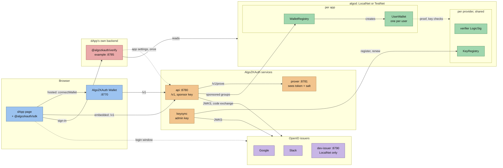
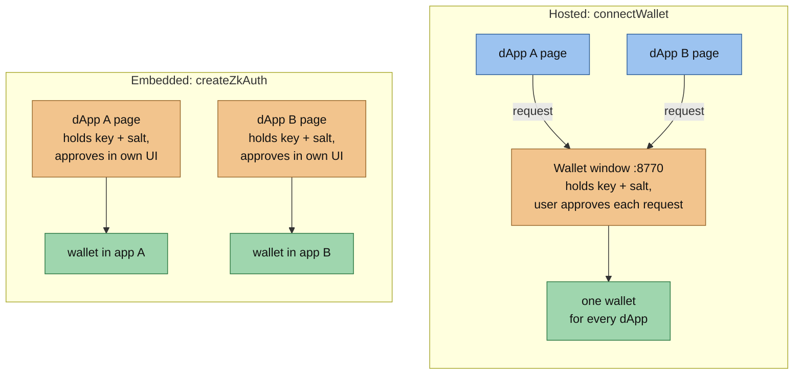
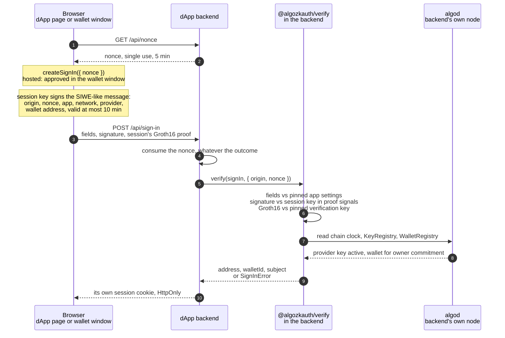

# Service architecture

AlgoZKAuth's login-controlled wallets packaged as services that any Algorand dApp can use. This file describes what is built: components, ports, configuration, the internal APIs and the hosted-wallet protocol. The public HTTP API is [services/api/openapi.yaml](../services/api/openapi.yaml); dApps use it through the browser SDK, [packages/sdk](../packages/sdk/README.md). Status and open work are in [PLAN.md](../PLAN.md).

## Components



Solid arrows are calls; dotted ones are the login window, the backend's one-time read of the app settings it pins, and the contracts' checks against the shared verifier LogicSig and KeyRegistry. Pages reach AlgoZKAuth only through the api (in hosted mode, only the wallet window does); the prover and keysync are internal.

| Component | Path | Role | Holds |
| --- | --- | --- | --- |
| protocol | `packages/protocol` | Nonce, identity commitment, action digest, recovery package, providers, token checks, circuit input, authorization code login (Node built-ins and WebCrypto only) | nothing |
| config | `packages/config` | Env defaults per network, role signers (with the legacy `TESTNET_MNEMONIC` fallback), the dev-issuer provider override, `apps.json`, deployment records | nothing |
| chain | `packages/chain` | Deploy, key registry, discovery, action groups ([README](../packages/chain/README.md)) | nothing; signers passed in |
| sdk | `packages/sdk` | Browser client: `createZkAuth` (the dApp holds the session) and `connectWallet` (the hosted wallet does); `@algozkauth/sdk/wallet-host` for the wallet's side; `createSignIn` for backend sign-in | session key (nonextractable), salt in memory |
| verify | `packages/verify` | For a dApp's backend: verifies a sign-in (session-key signature, Groth16 proof, KeyRegistry, WalletRegistry) against any algod node, trusting no AlgoZKAuth service ([README](../packages/verify/README.md)) | nothing |
| api | `services/api` | `/v1` REST: sessions, token checks, code exchange, salt binding, proofs, actions, sponsorship, quotas; a LocalNet faucet ([README](../services/api/README.md)) | sponsor key; tokens and salts in memory for at most a session |
| prover | `services/prover` | Groth16 proofs (rapidsnark, snarkjs fallback); internal only ([README](../services/prover/README.md)) | proving keys; private inputs only while a job runs |
| keysync | `services/keysync` | JWKS → key registry, renewals, bootstrap seal, guardian watch ([README](../services/keysync/README.md)) | administrator key |
| dev-issuer | `services/dev-issuer` | LocalNet-only OpenID issuer emulating a provider ([README](../services/dev-issuer/README.md)) | dev RSA key |
| cli | `tools/cli` (`zkauth`) | init, deploy, apps, keys, guardian, check, artifacts, `up --local` ([README](../tools/cli/README.md)) | whatever the command needs, from env |
| demo | `apps/demo` | Reference dApp: embedded session, backup/restore, enroll, faucet, transfers, and a "shared wallet" card | — |
| wallet | `apps/wallet` | The hosted AlgoZKAuth Wallet that dApps connect to | the user's session, salt and key at its own origin |
| example | `examples/send-algo` | The smallest integrations: `index.html` (embedded, four SDK calls) and `hosted.html` (`connectWallet`), each with a backend sign-in | — |
| example backend | `examples/backend` | A dApp backend that signs users in with `@algozkauth/verify` and issues its own cookie ([README](../examples/backend/README.md)) | its own sessions |

One key registry and verifier LogicSig per **provider per network**, shared by all apps. One `WalletRegistry` per **app** (audience), so the same login has a different wallet in each app. The hosted wallet is itself an app (`"shared": true` in `apps.json`); because every dApp reaches the user's wallet through it, a user has **one** wallet across all dApps that use it.

The original single-process TestNet demo was retired on 2026-10-22 (code at commit `e1b7589`); its recorded runs stay in `benchmarks/` and `evidence/check-demo.sh` (also `zkauth check`) still checks them read-only. The tools behind the recorded evidence are in [`evidence/`](../evidence/README.md).

## Two ways for a dApp to integrate



| | Embedded: `createZkAuth({ service, app })` | Hosted: `connectWallet({ walletOrigin })` |
| --- | --- | --- |
| Who holds the login session, salt and key | the dApp's page | the wallet window, at the wallet's origin |
| Wallet | one per user per dApp (the dApp's own audience) | one per user across every connected dApp |
| Backup | the dApp shows create/restore (the SDK does the work) | the wallet does, optionally remembered on the device |
| Approval of each action | the dApp's own UI (`approve` hook) | always in the wallet window |
| Registration with the service | an app entry with the dApp's OAuth client and origins | none: only the wallet app is registered |
| Backend sign-in | `session.createSignIn({ nonce })`; the backend pins the dApp's app | `wallet.createSignIn({ nonce })`, approved in the wallet; the backend pins the wallet's app |

## Backend sign-in

A dApp's backend learns which wallet a user controls without trusting the AlgoZKAuth service, the way a Sui zkLogin or Aptos Keyless backend verifies a signature against on-chain JWKs rather than asking a server.



- **Signing.** The session key signs a SIWE-like message (`packages/protocol/src/sign-in.mjs`). It names:
  - the page's origin (in hosted mode, the origin the wallet window saw);
  - the backend's nonce, the app's WalletRegistry, the network and provider;
  - the wallet address;
  - a validity of at most 10 minutes, inside the session.
- **What is sent.** The sign-in carries the session's Groth16 proof. The proof's public signals name that session key, and the api now returns the proof to the session that owns it. The proof and the signature are not secret: only the session key can produce new ones.
- **Verifying.** `@algozkauth/verify` rebuilds the message, then checks it against the app settings the backend pins and its own algod node:
  - the signature against the key in the signals;
  - the proof against the pinned verification key;
  - the session window against chain time;
  - the provider key in the KeyRegistry;
  - the wallet for the proof's owner commitment in the WalletRegistry.
- **What the backend gets.** The wallet address and `subject`, the owner commitment: stable per user and app, and anonymous.
- **Domain separation.** Sign-ins are signed under `algozkauth-sign-in-v1\0`, actions as a 32-byte digest under `algorand-zklogin-action-v1\0`, so neither can stand in for the other.
- **Trust.** What remains trusted is the provider, the circuit and its setup, and the algod node.
- **Compared with Sui and Aptos.** Unlike Sui's salt service and Aptos's pepper service, no service can link a user's apps, because the salt stays in the user's backup. Unlike Aptos, there is no "training wheels" prover signature guarding against circuit bugs (see PLAN.md, Phase 7).

## Ports

All overridable (`API_PORT`, `PROVER_PORT`, `KEYSYNC_PORT`, `DEV_ISSUER_PORT`; the web apps in their `vite.config.ts`).

| Component | Port | Exposure |
| --- | --- | --- |
| demo app | 8765 | host loopback (matches the existing OAuth origin) |
| wallet app | 8770 | host loopback |
| example dApp | 8775 | host loopback |
| example backend | 8785 | host loopback |
| api | 8780 | host loopback |
| prover | 8781 | internal network only |
| keysync health | 8782 | internal |
| dev-issuer | 8790 | host loopback (the browser visits its sign-in page) |
| algod / kmd (compose `local`) | 4101 / 4102 on the host | avoids AlgoKit LocalNet's 4001/4002 |

## Configuration

Environment (secrets never in files the repository tracks):

| Variable | Used by | Meaning |
| --- | --- | --- |
| `ZKAUTH_NETWORK` | all | `localnet` or `testnet` (`mainnet` refused until Phase 7) |
| `ZKAUTH_ALGOD_URL`, `ZKAUTH_ALGOD_TOKEN`, `ZKAUTH_INDEXER_URL` | api, keysync, cli | Node endpoints; defaults per network |
| `ZKAUTH_STATE_DIR` | all | Default `.local/service`; holds `apps.json`, deployments and `secrets.env` |
| `ZKAUTH_ADMIN_MNEMONIC` | keysync, cli deploy | Key-registry creator; never given to the api |
| `ZKAUTH_SPONSOR_MNEMONIC` | api, cli deploy (funding) | Pays enrollment deposits and group fees |
| `ZKAUTH_GUARDIAN_ADDRESS` | cli deploy, keysync | Guardian fixed at key-registry creation |
| `ZKAUTH_GUARDIAN_MNEMONIC` | cli guardian commands only | Kept off service hosts |
| `ZKAUTH_PROVER_URL`, `ZKAUTH_PROVER_TOKEN` | api, prover | Internal prover endpoint and shared bearer secret |
| `ZKAUTH_API_PUBLIC_URL` | api | Its browser-facing base URL (code-flow redirect `<base>/v1/oauth/<provider>/callback`) |
| `ZKAUTH_PUBLIC_ALGOD_URL`, `ZKAUTH_PUBLIC_INDEXER_URL` | api | Node URLs the app config gives the SDK |
| `API_SESSION_RATE_LIMIT`, `API_SESSION_RATE_WINDOW_SECONDS`, `API_TRUST_PROXY` | api | Session creation per client (30 per 60 s); `1` takes the client from `X-Forwarded-For` |
| `API_DEV_FAUCET` | api | `0` disables the LocalNet faucet |
| `ZKAUTH_DEV_ISSUER_URL`, `ZKAUTH_DEV_ISSUER_PUBLIC_URL` | api, keysync, cli | LocalNet only: provider endpoints point at the dev issuer; the public URL (default: the same) is the browser's address for its sign-in page |
| `DEV_ISSUER_ALGOD_URL`, `DEV_ISSUER_ALGOD_TOKEN` | dev-issuer | Stamp tokens on the chain's clock (see Clocks) |
| `ZKAUTH_KMD_URL`, `ZKAUTH_KMD_TOKEN` | cli | LocalNet only: the KMD dispenser `zkauth init` funds accounts from (default `http://localhost:4002`) |
| `KEYSYNC_INTERVAL_SECONDS`, `KEYSYNC_ALERT_WEBHOOK`, `KEYSYNC_ALERT_REPEAT_SECONDS`, `KEYSYNC_BIND` | keysync | Cycle period (900), alert webhook, repeat of a standing alert (21600), bind address |
| `PROVER_CONCURRENCY`, `PROVER_QUEUE`, `PROVER_JOB_TIMEOUT_SECONDS`, `PROVER_WORK_DIR` | prover | 1, 4, 900, mode-700 job directory |
| `<APP_SECRET_ENV>` | api | Per-app OAuth client secrets named in `apps.json` |
| `VITE_ZKAUTH_SERVICE`, `VITE_ZKAUTH_APP`, `VITE_ZKAUTH_WALLET` | web apps (build time) | API URL, app id and hosted-wallet origin |

`zkauth init` writes the role secrets and a random `ZKAUTH_PROVER_TOKEN` to `$ZKAUTH_STATE_DIR/secrets.env` (mode 0600, unquoted so `docker --env-file` and `node --env-file` read it alike); exported variables override it. On LocalNet it funds the admin, sponsor and guardian from KMD. Long-running services read it at start with `node --env-file-if-exists`.

Migration: when the role variables are unset on TestNet, `TESTNET_MNEMONIC` fills all three roles and `KEY_GUARDIAN_*` the guardian, with a warning, so existing `.env` files keep working.

`$ZKAUTH_STATE_DIR/apps.json` (written by `zkauth apps add`; the api reads it at start):

```json
{
  "apps": [
    {
      "id": "demo",
      "provider": "google",
      "clientId": "123.apps.googleusercontent.com",
      "clientSecretEnv": null,
      "redirectUri": null,
      "allowedOrigins": ["http://localhost:8765"],
      "shared": false,
      "sponsor": { "operations": ["0", "1", "2", "3"], "maxActionsPerSession": 20, "maxDailyFeeMicroAlgos": "2000000" }
    }
  ]
}
```

Deployment records (public data, written by the cli):

- `$ZKAUTH_STATE_DIR/deployments/<network>/providers/<provider>.json` — `ProviderDeployment`
- `$ZKAUTH_STATE_DIR/deployments/<network>/apps/<app>.json` — `AppDeployment`

## Internal APIs

### prover

- `POST /v1/prove` — `Authorization: Bearer $ZKAUTH_PROVER_TOKEN`; body `{ provider, input }` where `input` is `oidcCircuitInput(...)`. Returns `{ proof, publicSignals, measurement: { prover, witnessMs, proveMs, elapsedMs, peakRssBytes } }` after checking the proof against the provider's verification key and `expectedPublicSignals(input)`. Each job runs in its own worker process.
- One proof at a time by default; `429` with `Retry-After` when the queue is full.
- The input is never written to disk; the witness lives only in a mode-700 job directory, removed on completion, failure or startup. Nothing from the input is logged.
- `GET /v1/health` — `{ ok, rapidsnark, providers }`.

### dev-issuer (refuses to start unless `ZKAUTH_NETWORK=localnet`)

- Emulates `DEV_ISSUER_PROVIDER` (default `google`): tokens carry that provider's issuer and claim profile, built with `syntheticToken`, signed by a persisted dev RSA-2048 key (`kid` `dev-1`).
- `GET /.well-known/openid-configuration`, `GET /jwks`, `GET /v1/health`.
- `GET /authorize?client_id&redirect_uri&state&nonce` — sign-in page to pick or type a test subject (`alice`, `bob`, …), then redirects with a single-use code. With the dev issuer the provider's login flow is `code`.
- `POST /token` — code exchange → `{ id_token }` (in the shape `exchangeCode` expects).
- `POST /test/token` `{ audience, nonce, subject }` → `{ id_token }` for headless tests.

### keysync

- Every `KEYSYNC_INTERVAL_SECONDS` and at start: for each provider deployment, fetch JWKS and `ensureKeys` (registers new keys under the 24-hour approval delay, renews keys within three days of expiry, seals an unsealed bootstrap).
- Then the guardian check: a key that is or will become valid but is absent from the JWKS is an alert — a JSON log line and, if set, a POST to `KEYSYNC_ALERT_WEBHOOK`.
- `GET /v1/health` reports the last run per provider.

### api extras

- Every session response carries `networkTime`, now on the clock `expiresAt` uses, so clients can measure their skew (see Clocks).
- A ready proof job returns the proof with its public signals, for the session's sign-ins.
- `GET /v1/apps/:app/config` also answers requests without an Origin, so a backend can read the settings it pins.
- `POST /v1/apps/:app/dev/fund` `{ address }` — LocalNet only: 5 ALGO from the sponsor, six requests a minute per client, refused once the address holds 20 ALGO; 404 on other networks or with `API_DEV_FAUCET=0`.

## Hosted wallet protocol

`connectWallet` (dApp, [packages/sdk/src/hosted.ts](../packages/sdk/src/hosted.ts)) and `serveWallet` (wallet window, [packages/sdk/src/wallet-host.ts](../packages/sdk/src/wallet-host.ts)) exchange versioned `postMessage`s ([hosted-protocol.ts](../packages/sdk/src/hosted-protocol.ts)):

```
wallet → dApp   { type: "algozkauth:ready", v: 1 }
dApp → wallet   { type: "algozkauth:request", v: 1, id, method, params }      method: connect | account | sendAlgo | optIn | sendAsset | signIn | disconnect
wallet → dApp   { type: "algozkauth:response", v: 1, id, result }  or  { …, id, error: { code, message, retryAfter? } }
```

- The dApp opens the wallet window inside a click, accepts messages only from that window at `walletOrigin`, and posts only to `walletOrigin`.
- The wallet answers only the window that opened it, replies only to the requesting origin, and accepts nothing but `connect` from an origin the user has not approved. Every connection and every action is shown in the wallet window and runs only when the user approves it; a refusal reaches the dApp as `user_rejected`.
- The dApp learns the wallet's address, id, provider, network and balances, never the login identity, salt or key. Amounts travel as decimal strings.
- `signIn { nonce, statement? }` returns a signed sign-in (see Backend sign-in) whose origin is the requesting origin as the wallet window received it; a dApp cannot ask for one on another site's behalf.
- "Remember on this device" (opt-in, in the wallet) stores the backup and its secret in the wallet origin's `localStorage`, so later sign-ins from any dApp reopen the wallet without a restore. Approved origins are also remembered and can be disconnected in the wallet.

## Clocks

The proof's session window is checked on chain against the latest block's timestamp. A dev-mode LocalNet only makes a block when a transaction arrives, so its clock can fall minutes or hours behind wall time (TestNet's does not). The api therefore keeps session times on the chain's clock and reports `networkTime`; the SDK keeps `expiresAt` on that clock (it is signed into the nonce and proven) and applies its measured skew only to countdowns and timers; the dev issuer, given `DEV_ISSUER_ALGOD_URL`, reads the chain clock just before stamping each token.

## Compose

`docker compose --profile local up --build` (or `npm run stack:up`, detached; `npm run stack:down` stops it) runs: `algod` (dev mode with KMD, private network), `dev-issuer`, `init` (one-shot: proving artifacts, accounts, the `demo`, `example` and shared `wallet` apps, their deployments and the dev key), `prover`, `keysync`, `api`, `web` (the demo, wallet and example apps) and `example-backend`. The LocalNet chain, the deployment state, proving keys and the dev issuer's key live in named volumes, so `down` and `up` resume the same chain and `down -v` starts over; the repository's `.local/` is not mounted into service containers. `compose.testnet.yaml` runs the same stack on TestNet with Google sign-in (`npm run stack:testnet:up`): no `algod` or `dev-issuer`; its `init` creates the accounts and waits until they are funded, deploys the Google key registry (registering Google's current keys before sealing it) and the `demo`, `example` and shared `wallet` apps on one Google client; the example backend reads a public TestNet node. Its own project name (`algozkauth-testnet`) keeps its volumes apart from the local stack's. `node evidence/check-service-stack.mjs` re-verifies a run from public chain data ([record](../benchmarks/service-stack.testnet.json)).

Tests against the running stack: `npm run test:e2e` (Playwright, Chromium: login window, backup download, enrollment, faucet, transfers, recovery in a second browser profile, a passkey on a virtual PRF authenticator, a different wallet per app, the hosted wallet across two dApps, and backend sign-in from both example pages) and `npm run test:e2e:sdk` (the same wallet flow through the SDK in Node, and sign-ins verified against the chain, with 15 tampered or misdirected ones refused). Every other check is listed in [the development runbook](development.md#run-the-checks).

## Rules for every component

- Errors are typed codes with static messages (openapi `ErrorCode`); never echo SDK traces, tokens, request JSON or identifiers.
- No component logs tokens, salts, circuit input, session ids or mnemonics.
- `benchmarks/` is written only by evidence runs, never by services or tests.
- Tests that move LocalNet's block clock (`npm run test:localnet:key-delay`) never run alongside other LocalNet tests.
